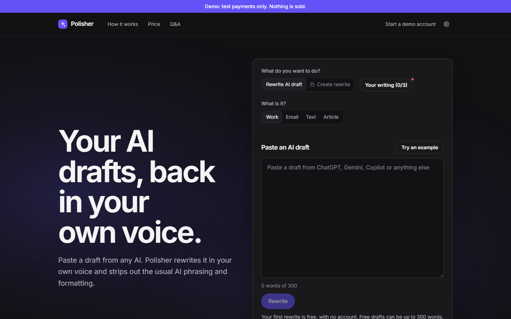
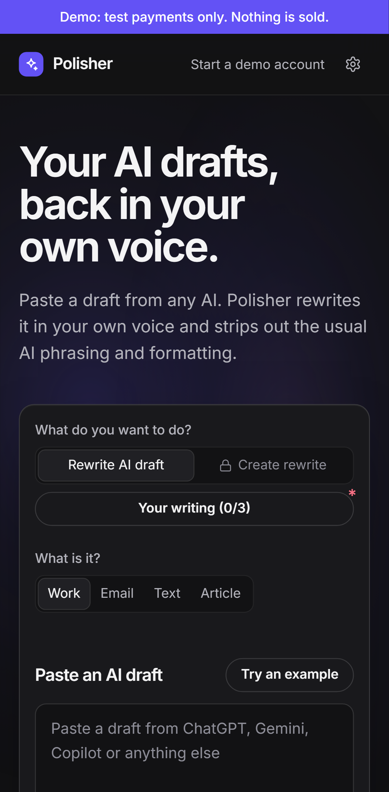
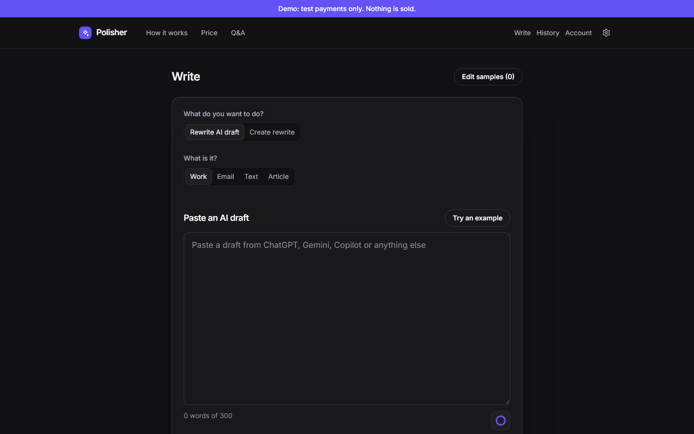
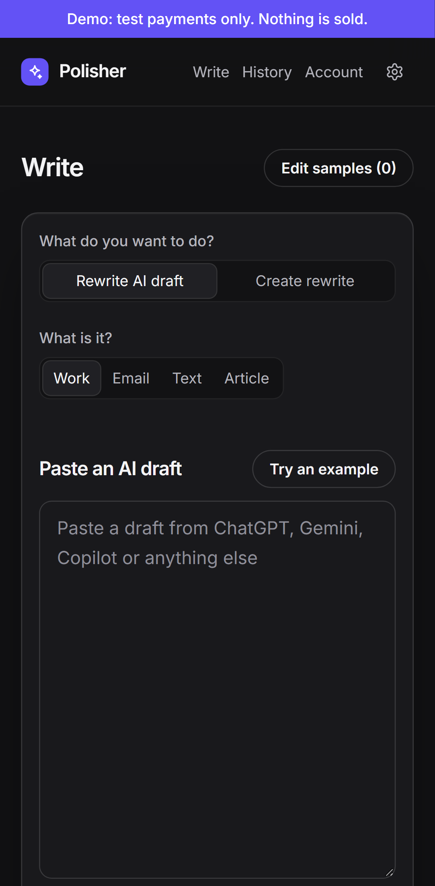
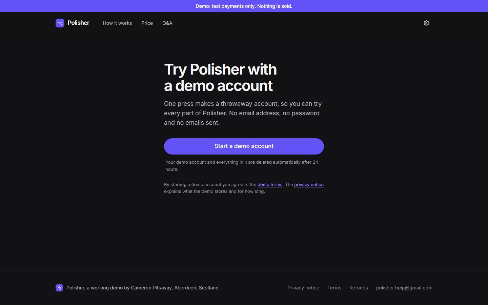
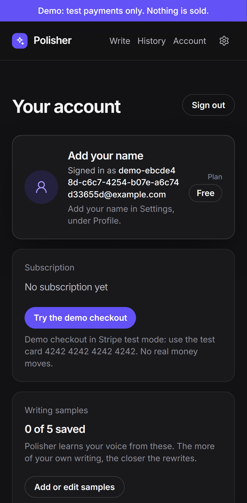

# Polisher

Polisher takes an AI draft and gives it back in your own voice. You paste 3 to 5 samples of your own writing, then paste an AI draft (or rough notes). A rule-based clean-up step strips AI habits (long dashes, stock phrases, hidden characters) and enforces British or American spelling. A meaning check then flags any number, link or quotation that changed.

It ran as a real £5-a-month product with live Stripe payments from 19 to 29 October 2026, as a 10-day validation test that was stopped a few hours early. It failed its own test, so the owner stopped selling and turned it into this portfolio demo. Nobody was charged. The full story is in `docs/CASE-STUDY.md`.

A portfolio project led by Cameron Pittaway, who made the product, design and business decisions.

## Live demo and code

Live demo: https://polisher-demo.vercel.app

Code: https://github.com/campit101/polisher

Every page carries the banner "Demo: test payments only. Nothing is sold."

## Screenshots

| Desktop | Phone |
|---|---|
|  |  |
|  |  |
|  |  |

## Try it

Press one button to get a throwaway demo account. It uses an example.com address, so no email is ever sent, and the database deletes it after 24 hours. Add your samples, paste a draft and press Rewrite. To try the paid plan, use Stripe's test card `4242 4242 4242 4242`, any future expiry date and any CVC. No real card is ever charged.

Rewrites are made by Claude Haiku 5.5 (Anthropic) inside a hard shared budget of about £0.10 a day for all visitors. Once that is used up, the site shows real ready-made examples instead.

## Features

- Learns your voice from 3 to 5 samples of your own writing.
- Rewrites an AI draft or rough notes in that voice.
- Clean-up step that removes long dashes, stock phrases and hidden characters, and enforces British or American spelling. Links, email addresses, code and quotations are left untouched.
- Meaning check that flags any number, link or quotation that changed.
- Credit-based usage, counted by the word (one credit is 100 words), with daily and monthly limits.
- Stripe Checkout and Customer Portal in test mode, confirmed by a signed webhook.
- One-press throwaway demo accounts, deleted after 24 hours by an hourly database job.
- Light and dark themes and a phone layout, with automated accessibility checks (axe-core in the Playwright suite).

## How it works

1. The Next.js app sends your draft to a Supabase Edge Function (Deno) with your session token.
2. The function checks rate limits and your allowance, builds a style profile from your samples, and calls Claude Haiku 5.5. Your text always sits in delimited data blocks, and the model has no tools.
3. The cost of every call is recorded in nano-dollars (whole billionths of a dollar) so sums never drift, and a global daily ceiling stops all AI spend once it is reached.
4. The rule-based clean-up step and the meaning check run on the result before you see it.

Polisher's own servers never save drafts or rewrites. They are sent to Anthropic to be rewritten, so Anthropic's own data rules apply to them. The last 5 rewrites are kept in your own browser only.

## Stack

| Part | What is used |
|---|---|
| Framework | Next.js 16.4.2 (App Router, server actions), React 19.2.8, TypeScript |
| Styling | Tailwind CSS |
| Database and sign-in | Supabase (Postgres in London, row-level security on every table) |
| AI calls | Supabase Edge Function in Deno, Claude Haiku 5.5 |
| Payments | Stripe 23.0.0 Checkout and Customer Portal, test mode only |
| Hosting | Vercel, London |
| Tests | Vitest 5.0.4, Playwright 1.64.0 with axe-core, Lighthouse 13.5.0 |

## Quality and measured results

- Tests, measured 29 October 2026, all passing: 1,600 unit tests, 73 integration tests (run against a separate test database) and 200 Playwright end-to-end tests at phone and desktop sizes.
- Lighthouse mobile on the landing page, median of 5 runs, measured 18 October 2026 (before the demo changes): 94 performance, 100 accessibility, 100 best practices, 100 SEO.
- Blind comparison, 15 October 2026: I judged 20 pairs without knowing which was which, and picked Polisher's rewrite over a plain rewrite 14 times. This is one person's judgement, not a study.
- Real-world result of the paid test: 143 front-page views (the owner's own included), 2 free tries, 0 sign-ups from strangers and 0 payments.

## Security and privacy

- A source-only security audit on 29 October 2026 found no confirmed vulnerability. It raised four leads that needed a deployment fact to settle, and all four were fixed anyway: a hard daily AI spending limit enforced by an atomic reservation, a linear-time clean-up pattern, fixed links in the Stripe portal settings, and a personal-data check on the public export.

- Stripe test mode only, enforced in code at run time and at build time. Any key that does not start `sk_test_`, `rk_test_` or `pk_test_` is refused.
- Row-level security on every table.
- Per-account rate limits, input size caps, a limit on the signed-out free try and a global daily AI spend ceiling.
- User text always in delimited data blocks, and the model has no tools.
- Polisher's servers never save drafts or rewrites.
- A written security review was done before launch, on 15 October 2026, and its findings were addressed.

## Running locally

You need Node 22 or newer, your own Supabase project (with the pg_cron extension available), your own Stripe account in test mode, and an Anthropic API key. Secrets live in `.env.local`, which is git-ignored, and are never committed. This is a demo, so no live Stripe key will work, by design.

1. Install and copy the example settings:

```
npm ci
cp .env.example .env.local
```

2. Fill in `.env.local`. The app reads these variables: `NEXT_PUBLIC_SUPABASE_URL`, `NEXT_PUBLIC_SUPABASE_PUBLISHABLE_KEY`, `SUPABASE_SECRET_KEY`, `STRIPE_SECRET_KEY` (a `sk_test_` or `rk_test_` key), `STRIPE_WEBHOOK_SECRET`, `STRIPE_PRICE_ID` and `IP_HASH_SALT` (any long random string). Some lines in `.env.example` are left over from the paid launch and are not needed.
3. Apply the SQL files in `supabase/migrations/` to your Supabase project, in file-name order.
4. Deploy the `rewrite` function from `supabase/functions/rewrite` to your Supabase project (the Supabase CLI's `supabase functions deploy rewrite --no-verify-jwt` does this) and set its `ANTHROPIC_API_KEY` secret in the Supabase dashboard.
5. Start the app:

```
npm run dev
```

Checks:

```
npm run verify
npm test
npm run test:integration
npm run e2e
```

`npm run verify` runs lint, types, unit tests, a build and a secret scan. The integration and end-to-end tests need a separate test database set up in `.env.local`, and the end-to-end tests also need `npx playwright install` once.

## Licence and credits

- No licence is granted: all rights reserved. You are welcome to read the code.
- No testimonials, ratings or user numbers appear anywhere beyond the measured results above.
